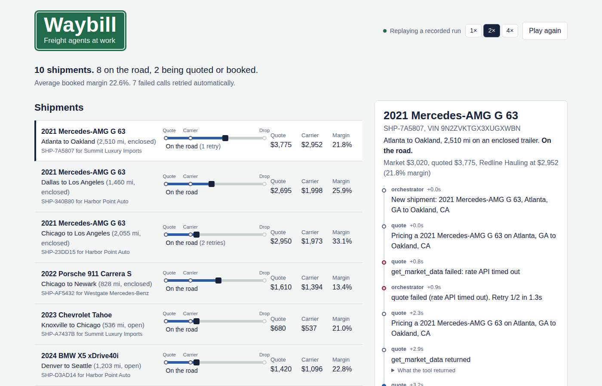
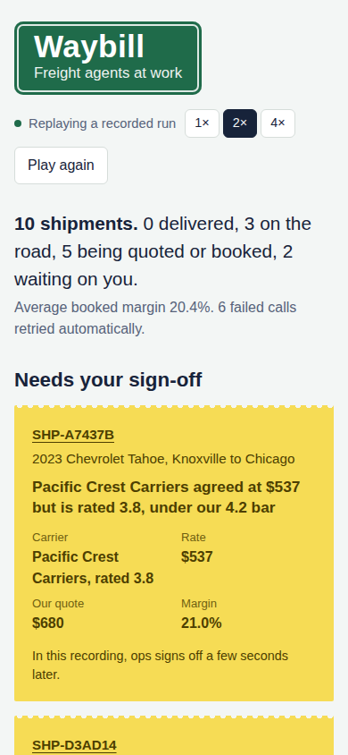
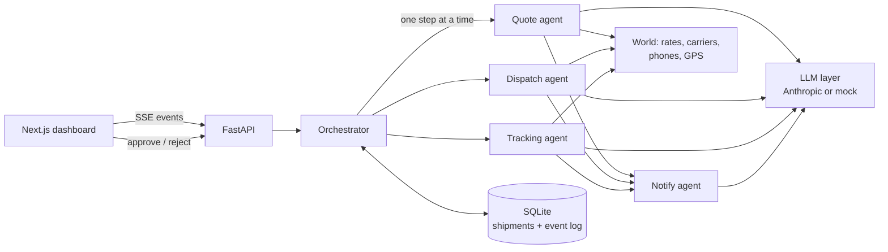

# Waybill

Waybill runs a small fleet of AI agents that quote, book, and track vehicle shipments, many at once. It's built around the parts that make agents dependable rather than impressive in a demo: durable state, retries, guardrails, a human sign-off step, and a trace of every decision.

**Live demo:** _add your Vercel link here_ (replays a recorded run, no backend needed)



## What it does

A dealership needs a car moved from Atlanta to Oakland. Four agents split the work:

- **Quote** pulls today's market rate for the lane and prices the move. A model picks the markup, and code clamps it to a sane range afterwards.
- **Dispatch** ranks carriers by rating, on-time history and price, then negotiates by "phone" round by round. It never offers above the ceiling that protects our margin.
- **Tracking** reads GPS pings and the driver's texts ("dot inspection at the scale, gonna be late"), works out what actually happened, and keeps the ETA honest.
- **Notify** writes the customer updates, with a check that our carrier rate never leaks into a message.

When a deal looks off, like a carrier rated under 4.2 or a margin below 12%, the shipment stops and waits on a person. The dashboard shows it as a canary-yellow slip with the reason, and you can book it or send dispatch back out.



## How it's put together



Every shipment is a small state machine:

```
new -> quoted -> booked -> in_transit -> delivered
          \-> needs_approval  (parked until a person decides)
any stage -> failed           (retries ran out, flagged for ops)
```

A few decisions worth calling out:

**Checkpoints, not hope.** Each step loads the shipment fresh from SQLite, lets one agent work on it, and saves only if the step finished. If the rate API times out halfway through quoting, nothing half-written gets saved and the step runs again from the last checkpoint. Kill the server mid-run and `resume()` picks every shipment back up where it was. There's a test for that.

**Retries with a ceiling.** Calls to the outside world fail on purpose (set `WAYBILL_FAILURE_RATE` to watch it). Transient errors get exponential backoff with jitter. After three tries the shipment is escalated instead of retried forever. Unexpected exceptions aren't retried at all, because a bug won't fix itself on the second attempt.

**The model proposes, code decides.** Prices, offers, and messages all come from the LLM, and each one passes a plain-code check before it touches anything real. `test_guardrails_hold_when_the_model_misbehaves` swaps in a fake model that quotes $99,999, offers $50,000, and tries to leak the carrier rate, then checks that none of it gets through.

**Concurrency limits per step, not per shipment.** A semaphore caps how many agent steps run at once. Shipments that are just waiting for the next GPS ping don't hold a slot, so a long haul doesn't block new quotes.

**Everything is an event.** Every tool call, decision, retry, and message is written to an append-only log before it's streamed to the dashboard. The UI rebuilds its whole state from that stream, which is also why the hosted demo can replay a recorded run with the exact same code.

## Running it

Backend (Python 3.12):

```bash
cd backend
pip install -r requirements-dev.txt
pytest -q
uvicorn waybill.api:app --reload
```

Dashboard:

```bash
cd frontend
npm install
echo "NEXT_PUBLIC_API_URL=http://localhost:8000" > .env.local
npm run dev
```

Open http://localhost:3000, click **Start 6 shipments**, and watch.

With no API key it uses a mock LLM: hand-written policies sitting right next to each prompt in `agents.py`. Set `ANTHROPIC_API_KEY` to have Claude make the calls instead. Other knobs: `WAYBILL_FAILURE_RATE`, `WAYBILL_CONCURRENCY`, `WAYBILL_SIM_SPEED`, `WAYBILL_MODEL`.

To refresh the recording the hosted demo replays:

```bash
cd backend
python scripts/record_demo.py --count 10 --out ../frontend/public/demo-run.json
```

## Deploying

- **Dashboard:** import the repo into Vercel and set the root directory to `frontend`. Without `NEXT_PUBLIC_API_URL` it replays the recorded run.
- **API:** `backend/Dockerfile` runs on Render, Railway, or Fly. Point `NEXT_PUBLIC_API_URL` at it to go live.

## What's simulated

The outside world is fake: rates, carriers, phone calls, GPS, and driver texts all come from `world.py`. The numbers are in a believable range for single-vehicle car hauling, but they aren't from a real rate index. Carriers have hidden walk-away prices, which is what makes negotiation interesting to test.

## What I'd do next

- **Idempotency keys on outbound messages.** If a step fails after the notify agent sends a text, the retry can send it again. Fine for a demo, not fine for a customer's phone.
- **A real queue.** In-process asyncio tasks are enough here. With multiple workers, I'd move to Postgres-backed jobs or Temporal, and use the same checkpoint model.
- **Evals on live outcomes.** Negotiation and parsing are scored offline in [Lanebench](https://github.com/harish04010/lanebench). The next step is tracking savings, on-time rate, and escalations per agent version on real shipments.
- **Voice.** Swap the simulated phone call for a real voice agent on Twilio, and keep the transcript in the trace.
